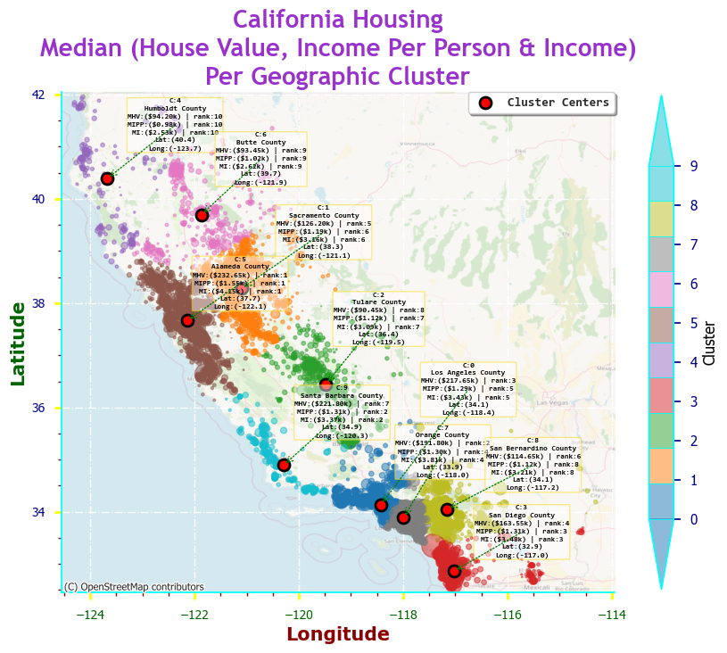
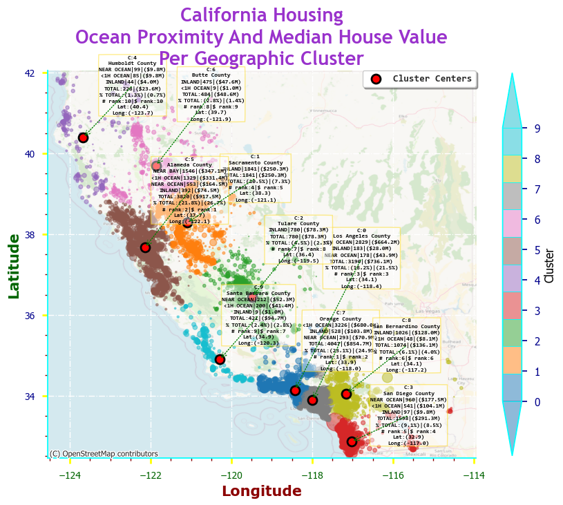
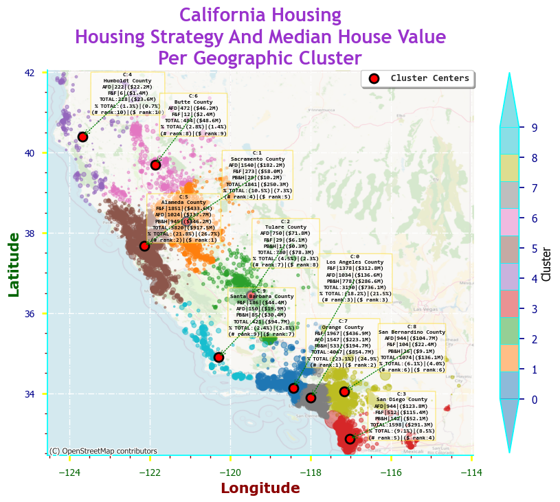
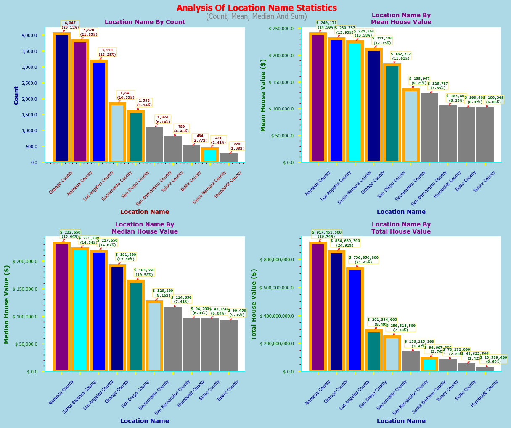
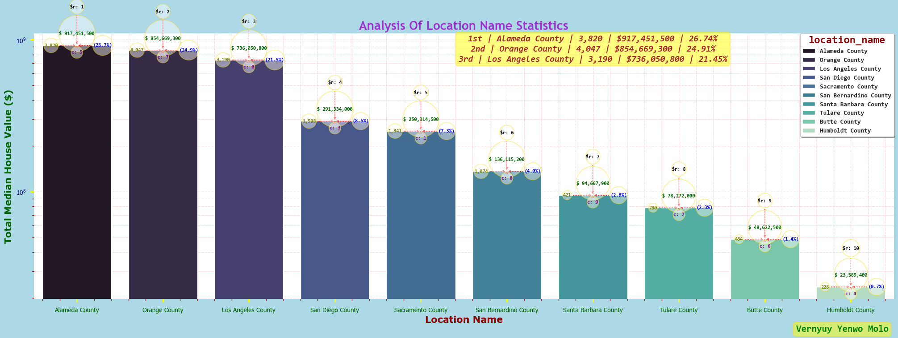

#

#
# `👋 Introduction`:
**🏠📊 Dive into the California Housing Market!. 😎👌**
# `🚀 Python Code`:
1.**[Unsupervised Learning](https://github.com/ArkylTrulock/Analytics_VA/tree/main/Python_Projects/California_Housing_Market_Data_Analysis/2_Unsupervised_Learning)**:

  - **[Median House Price Clustering](./2_Unsupervised_Learning/Median_House_Price_Clustering.ipynb)**
    - **[Charts/Assets](https://github.com/ArkylTrulock/Analytics_VA/tree/main/Python_Projects/California_Housing_Market_Data_Analysis/2_Unsupervised_Learning/Assets_MHV_Price_Clustering)**

  - **[Socioeconomic Spatial Housing Analysis](./2_Unsupervised_Learning/Socioeconomic_Spatial_Housing_Analysis.ipynb)**
    - **[Charts/Assets](https://github.com/ArkylTrulock/Analytics_VA/tree/main/Python_Projects/California_Housing_Market_Data_Analysis/2_Unsupervised_Learning/Assets_SSH_Analysis)**
- --
2.**[Supervised Learning](https://github.com/ArkylTrulock/Analytics_VA/tree/main/Python_Projects/California_Housing_Market_Data_Analysis/3_Supervised_Learning)**:

  - **[Median House Price Prediction](./3_Supervised_Learning/Median_House_Price_Prediction.ipynb)**
    - **[Charts/Assets](https://github.com/ArkylTrulock/Analytics_VA/tree/main/Python_Projects/California_Housing_Market_Data_Analysis/3_Supervised_Learning/Assets_MHP_Prediction)**
#
# `🤖 Project Overview`:
**I developed a machine learning housing analytics model using KMeans clustering and regression analysis to carry out**:

1. **`Median House Price Clustering`**.
2. **`Socioeconomic Spatial Housing Analysis`**.
3. **`Predict Median House Prices`**.
#
# `🎯 Project Objectives`:
  1. **Predict median house values based on features like income, room ratios, housing age and location**.
- --
  2. **Identify and analyse the distribution of housing values across key California locations**.
- --
  3. **Segment California housing markets into meaningful clusters using KMeans clustering**.
- --
  4. **Determine the best housing investment strategy (`PB&H`, `F&F` or `AFD`) per geographic location**.
  - **`PB&H`**: **Premium Buy & Hold**.
  - **`F&F`**: **Fix & Flip**.
  - **`AFD`**: **Affordable Development**.
- --
  5. **Visualise geographic housing patterns across California using geospatial mapping**.
- --
  6. **Explore the relationship between ocean proximity, median income and median house value**. 
- --
  7. **Provide data-driven prescriptive recommendations for housing strategy selection by location**.
#
# `🧰 Tech Stack`:
- Python (`pandas`, `numpy`, `seaborn`) 
- Jupyter Notebook
#
# `🧠 Methods & Tools`:
**Python Libraries**:

- **`Pandas`**: **Data analysis and manipulation**. 
- **`Numpy`**: **Scientific computing**.  
- **`Seaborn`**: **Statistical data visualisation**.
#
# `🗺️ Key Insights - Socioeconomic Spatial Housing Analysis`:

   - **`🏆 Tier 1 (Highest) — Alameda County (C5, \$917.5M | 26.7% | 3,820 count | 21.8%) — 1st by ($) value, 2nd by (#) count`**.

   - **`🥈 Tier 2 (High) — Orange County (C7, \$854.7M | 24.9% | 4,047 count | 23.1%) — 2nd by ($) value and 1st by (#) count`**.

   - **`🥉 Tier 3 (Mid-High) — Los Angeles County (C0, \$736.1M| 21.5% | 3,190 count | 18.2%) — 3rd by ($) value and 3rd by (#) count`**.

   - **`4️⃣ Tier 4 (Mid) — San Diego County (C3, \$291.3M | 8.5% | 1,598 count | 9.1%) and Sacramento County (C1, \$250.3M | 7.3% | 1,841 count | 10.5%)`**.

   - **`5️⃣ Tier 5 (Mid-Low) — San Bernardino County (C8, \$136.1M | 4.0% | 1,074 count | 6.1%) and Santa Barbara County (C9, \$94.7M | 2.8% | 421 count | 2.4%)`**.
   
   - **`6️⃣ Tier 6 (Lowest) — Tulare County (C2, \$78.3M | 2.3% | 780 count | 4.5%), Butte County (C6, \$48.6M | 1.4% | 484 count | 2.8%) and Humboldt County (C4, \$23.6M | 0.7% | 228 count | 1.3%)`**.
- --
**`🎯 General Pattern`**:

  - **`📈 Coastal areas`** = **`higher prices`**.

  - **`📉 Inland/Rural areas`** = **`lower prices`**.

  - **`This confirms that location is a strong predictor of house prices! 🏠`**.
- --
**Cluster Map - Median (House Value, Income Per Person & Income) Per Geographic Cluster**:
- --

*Generated using seaborn library*.
- --
**Cluster Map - Ocean Proximity And Median House Value Per Geographic Cluster**:
- --

*Generated using seaborn library*.
- --
**Cluster Map - Housing Strategy & Median House Value Per Geographic Cluster**:
- --

*Generated using seaborn library*.
- --
**Bar Plot - Analysis of Location Name Statistics 1**:
- --

*Generated using seaborn library*.
- --
**Bar Plot - Analysis of Location Name Statistics 2**:
- --

*Generated using seaborn library*.
#
# `🗺️ Key Insights - Median House Price Prediction`:
- --
  - **`Log transform did not help overall`**.
  - **`MAE did not improve — model is not better on mean average errors`**.
  - **`RMSE did not improve — model is not better on root mean squared errors`**.
  - **`This tells us the data may not be as skewed as expected`**.
- --
**`🎯 Conclusion`**
  - **`⚠️ RMSE of $40k — XGBoost Model was better ($39k)`**.
  - **`✅ MAE of $27k — Same as XGBoost Model ($27k)`**.
  - **`⚠️ R² of 80.44% — XGBoost Model was better (81.54%)`**.
  - **`🏅 Our best performing model uses XGBoost tuned with clean data (not log transformed target variable), explaining 81.54% of house price variance with an average error of ~$27k 🏡`**.
#
# `🌍 Real World Application`:
- **`Inform Decision-Making for Buyers & Sellers`**: **Accurate predictions help buyers negotiate fair prices and sellers set realistic listing values**.

- **`Investment Opportunities`**: **Enables investors to identify undervalued properties and promising markets for higher returns**.

- **`Mortgage Lending & Risk Assessment`**: **Assists financial institutions in evaluating collateral value and borrower affordability to reduce lending risks**.

- **`Market Analysis & Efficiency`**: **Reveals trends and dynamics to improve overall real estate market transparency and liquidity**.
- **`Policy-Making & Urban Planning`**: **Supports governments in forecasting housing affordability, costs of living, and development policies**.
#
## `📬 Contact`:
*Built by [Arkyl Trulock](https://github.com/ArkylTrulock)*  
For collaborations or feedback: vanalytics1120@gmail.com